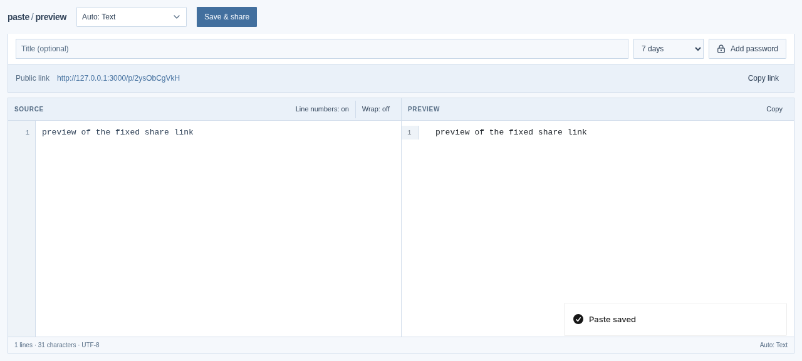
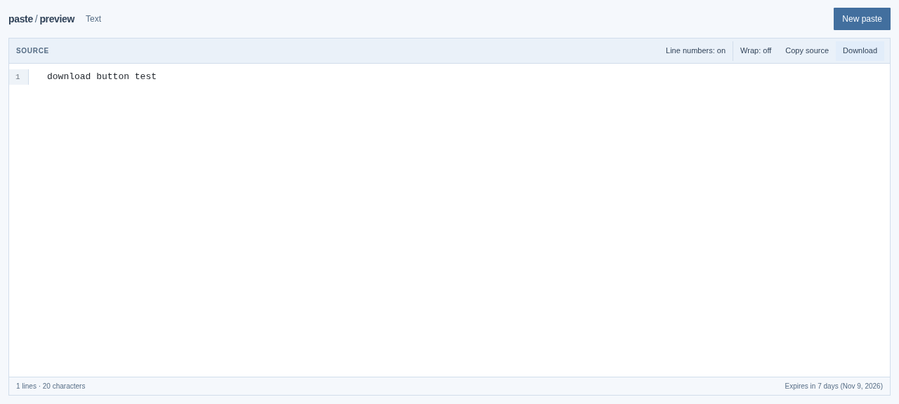

# Paste Preview

Share code, Markdown, and HTML through public links. Each paste can have a title, an expiry, and an optional password. Built with TanStack Start and deployed on Cloudflare Workers.



## Features

- Paste code, Markdown, HTML, or plain text.
- Detect the language automatically, or choose one from the list.
- Set a title, an expiry from one hour to thirty days, and an optional password.
- Preview Markdown inline and HTML in a sandboxed iframe.
- Download the shared source with the matching file extension.
- Password protection gates access to the paste. It does not encrypt the stored content.



## Stack

- TanStack Start and React 19
- Effect-TS
- Panda CSS
- Cloudflare Workers and KV

## Development

```sh
vp install   # install dependencies
vp dev       # start the dev server
```

## Checks

```sh
vp run check          # format and lint
vp run test:run       # tests
vp exec tsc --noEmit  # typecheck
vp build              # production build
vp run doctor --verbose
```

## Deploy

```sh
vp run alchemy:login   # once, to connect the Cloudflare account
vp run deploy
```

Live at [preview.ryuko.my.id](https://preview.ryuko.my.id).
